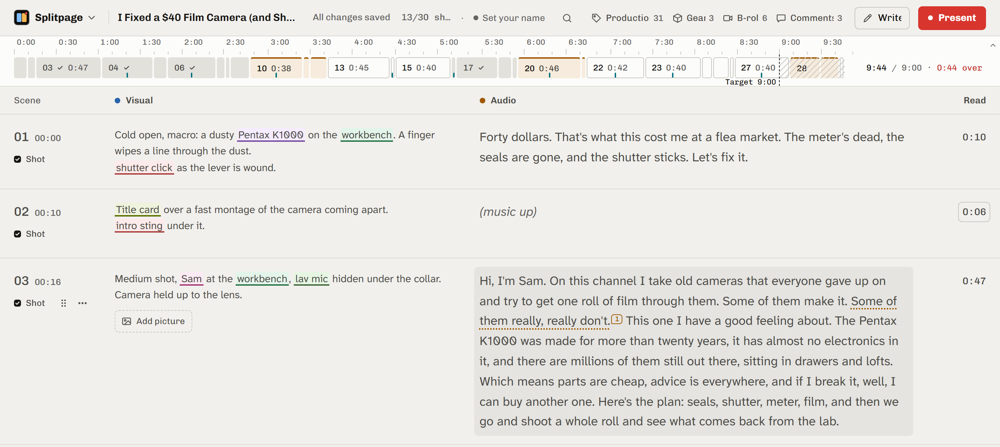
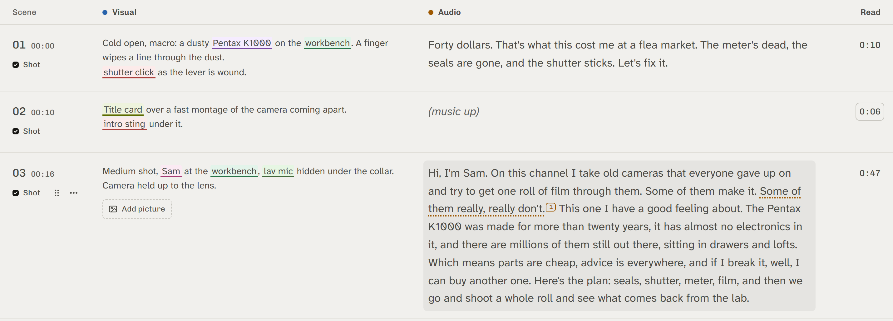
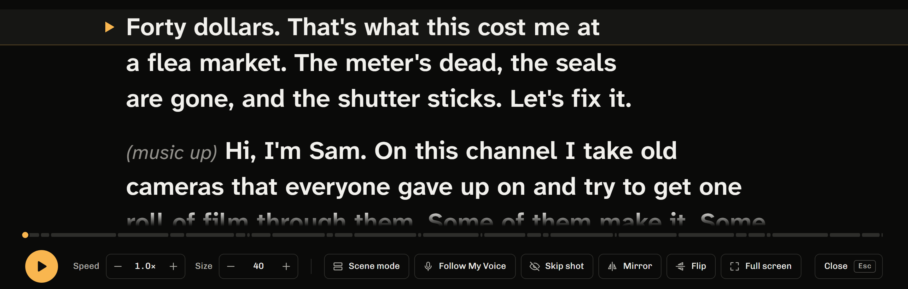
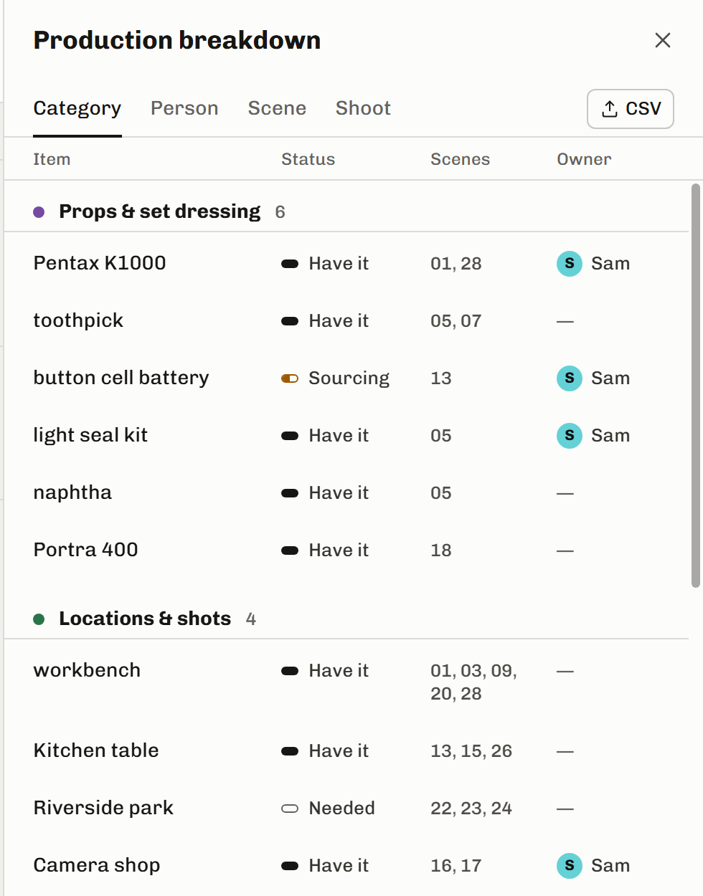
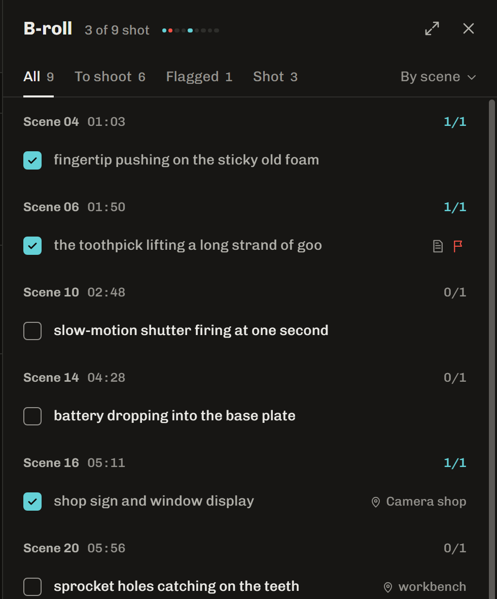
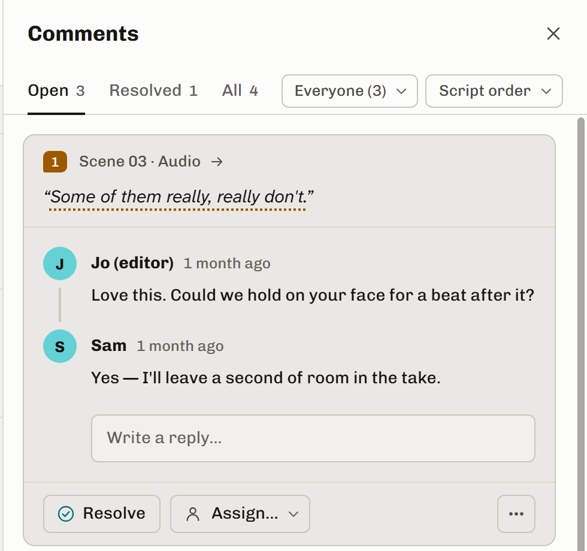
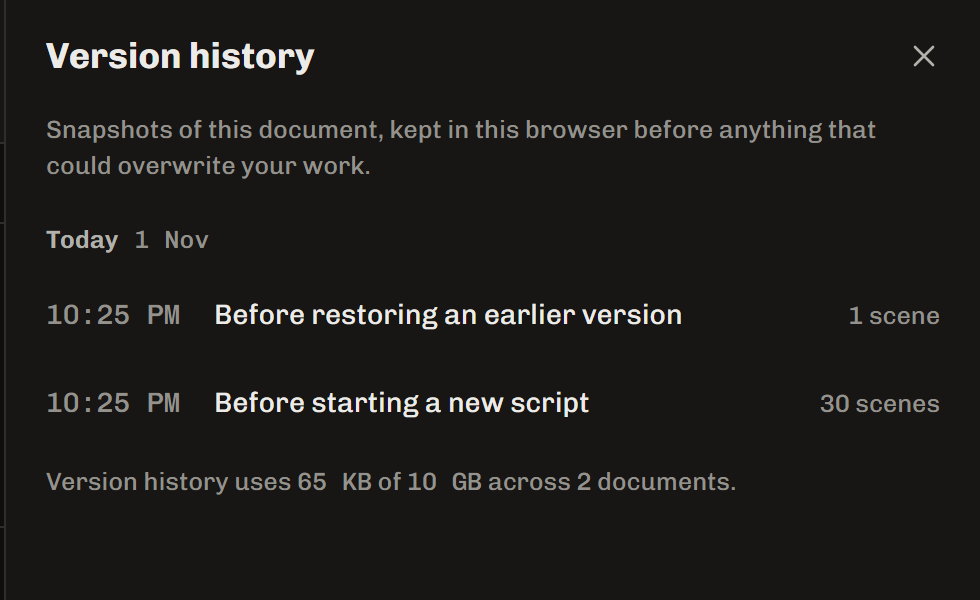
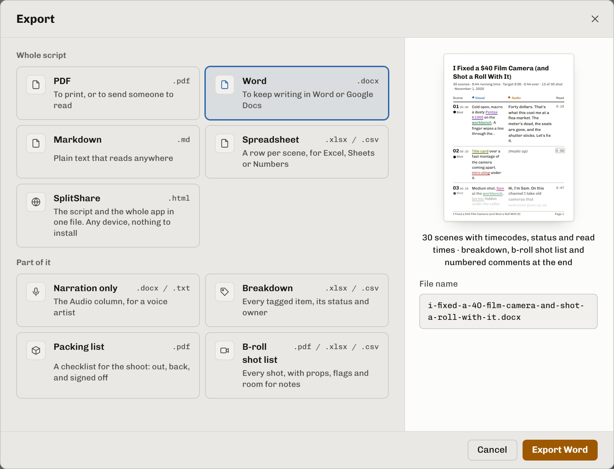

# Splitpage

Splitpage is a two-column visual/audio script editor for people making
videos. Write what the viewer sees beside what they hear, plan the shoot,
and read the narration from a teleprompter.



*0.4.1-era interface. Current main calls the rows beats and the completed status Filmed.*

## Get Splitpage

The latest published release is [0.4.1, released 2026-11-02](https://github.com/RetroGorilla/splitpage/releases/tag/v0.4.1).
The source on `main` includes unreleased changes for **0.4.3**. See the [roadmap](docs/ROADMAP.md) for merged work and plans still in flight.

Download the Windows installer or the portable zip from the
[latest release](https://github.com/RetroGorilla/splitpage/releases/latest).
The installers are unsigned, so Windows SmartScreen warns on first run: choose
**More info**, then **Run anyway**.

To build from source, install the Node version in [.nvmrc](.nvmrc), then:

```sh
git clone https://github.com/RetroGorilla/splitpage.git
cd splitpage
npm ci
node build.mjs
```

Open the generated `index.html` in your browser. To serve it locally, run
`start.bat` on Windows or `./start.sh` on macOS or Linux. For a Windows
desktop build, see the [development guide](docs/DEVELOPING.md).

You can write and save scripts offline. The desktop app saves directly to
your files; Chrome and Edge also support saving back to the same file.
Other browsers download a fresh copy when you save. Linked online videos
and browser speech recognition need an internet connection.

Start with the example script, or open the long demo to explore a complete
video. The [user guide](docs/help.md) explains the controls. The screenshots
below show the long demo in the 0.4.1-era interface: its individual rows were
called scenes, its completed status was Shot, and Present used Scene mode.
Current `main` calls these beats, Filmed and Beat mode. The descriptions below
use current terms; the user guide separates changes since 0.4.1.

## Write the picture and the words together

Each beat keeps its visual notes beside its narration, with a read-time
estimate and a To do, Ready or Filmed status. Named scene headers group beats,
with labels such as A1 and B1. The rundown above the script shows its pace and
length; click a beat to jump to it. Write opens narration as a flowing document.



## Read from the teleprompter

Present turns the Audio column into a teleprompter with adjustable speed
and text size. Play one beat at a time, skip filmed beats, or mirror
the text for a teleprompter display.



## Turn script notes into a production breakdown

Tag props, locations, cast, effects, sound and gear as you write. The
breakdown gathers each item with the beats that need it, its status and
the person responsible. Scene prep walks through requirements by scene and
beat; By scene also groups Production, Gear, B-roll and Comments.



## Keep a b-roll shot list

Start a visual line with `B-roll:` and it becomes a shot on the list. Tick
off footage as you get it, group shots by location, and flag a take that
needs shooting again.



## Leave notes where they belong

Anchor a comment to words in either column, reply in its thread and resolve
it when the change is done. Clicking a comment takes you back to the passage
it refers to.



## Go back to an earlier draft

Version history keeps snapshots on your computer before changes that could
replace your work. Open the history for the current script and restore an
earlier version when you need it.



## Take the script into production

Export the script as PDF, Word, Markdown or a spreadsheet. You can also
export just the narration, production breakdown, packing list or b-roll
shot list, depending on what the next person needs.

Attach pictures and local files to beats. In the desktop app, Create bundle
gathers linked files beside the script, and exporting a Splitpage script can
include that folder in one zip. Pictures are embedded in saved projects;
browser sessions cannot reopen saved local file paths.



## Project information

[Development setup and source map](docs/DEVELOPING.md) ·
[Developer handoff](docs/HANDOFF.md) ·
[Contributing](CONTRIBUTING.md) ·
[Security](SECURITY.md) ·
[Changelog](CHANGELOG.md) ·
[MIT licence](LICENSE)
