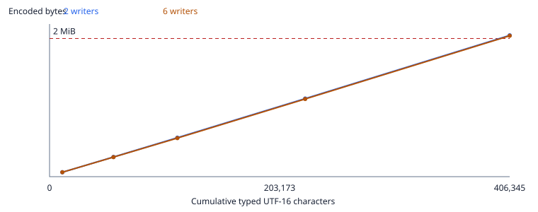

# Candidate B: writing lifetime, retained bytes and remote-character work

**Historical T21 scalar finding, now repaired:** before the status-resolution change, 80/96 delivery/client/recreation cases disagreed despite byte-identical encoded state. The original observations and minimized history remain intact in src/perf/lifetime/status-order.json and [T21-scalar-map-order.md](histories/T21-scalar-map-order.md). The shared causal-ancestor resolver now returns literal todo in 96/96 cases through every status reader. See [status-resolution-results.md](status-resolution-results.md) for retirement, checker controls and other-reader findings. Timings below predate this fix.

This follow-up studies the selected stable-segment candidate B. It does not select a schema, design compaction or establish a production lifetime. One modeled canonical draft plus its stated revision is the small lifetime control; larger horizons append the same canonical structure as the existing SCALE fixture does. Two/six writers alternate whole beats with causal delivery between turns, not simultaneous conflicting keystrokes. The M1 queue and app binding are not instantiated here.

Source SHA-256: 071bf6e9ba173a7eeaf9ab2921e8599b859927e42cd39ea13118072740c03472; dependency SHA-256: cc88dfeb2d10d283648d5bf3845884b6de8a06c6f8557db35692ddf0f3ad9f0a; canonical input SHA-256: 6f8d5731552da0152bf220596cc4b70cc58820895c5035d05a95af130ca23b34. Counts have no clock. Node v24.22.1; pinned Yjs 13.6.33. All limits remain those of artifact 7: 2,097,152 encoded bytes, fresh ≤3x/export and heavily edited ≤10x/export, remote visible-character p50 ≤30 ms / p95 ≤50 ms. A Node component can fail these latency ceilings; passing it does not prove message-to-frame.

## Stated writing scenario

The repository contains no observed human correction or revision rate. These are reproducible scenario parameters derived from its fixture/trace/recorder constants, not a claim about typical writers. They replace the earlier metadata-heavy stress mix, not its findings.

| Parameter | Literal value and repository justification |
| --- | --- |
| correctionEvery | artifact 7 section 4: 55-character typing case; one correction per case is a stated scenario, not telemetry |
| revisionBeats | tools/perf-record.mjs SPLITS=5 out of the canonical 30 beats; reuse that intervention count |
| revisionDivisor | artifact 8 T01 replaces original bc in abcd: half the original characters |
| structure | five recorder splits, their five T06 joins/semantic retirements, five supported whole-segment MOVE interventions |
| removals | T10 retained removal, plus one remove/restore control; one of each per canonical block |
| status | todo/ready/shot workflow: two transitions on each canonical beat |
| commentsAndTags | largest canonical fixture has four comments and 31 production tags; one review change each per block |
| pictures | artifact 7 images fixture inserts ten pictures; once per script, references only |
| writers | plan trusted group is two to six; writers take consecutive beats, with causal delivery at beat boundaries |
| horizon | one block is one canonical draft plus its partial revision; append canonical blocks as SCALE.grow does until the cap |

The canonical 30-beat long demo supplies both narration and visuals, marks, four comment records, 31 tag records, two people and shot metadata. The structure/registries are created first with empty text. Each text string is inserted one UTF-16 unit per transaction, consecutive positions by one writer; protected who/b-roll atoms are inserted as atoms. After each 55 original text units, backspace/retype that unit. Later, five beats have the first half of narration replaced by text from the following canonical beat, typed in a run. Each block then receives five splits and five per-writer joins followed by semantic retirement; the split boundaries remain. Five unsplit last beats move to the front through the existing first-occurrence segment-order mechanism. Two beats are soft-removed; one is explicitly restored. Each original beat receives ready then shot, each comment/tag one review update. Ten hash-only pictures are inserted once for the entire script. Blocks after the first reuse people/tags and retarget canonical beat/comment/shot ids.

A backspace is one character deletion; each revision deletion is one range command. Operation counts below exclude delivery/initial metadata and count character insert transactions individually. Typed characters include original typing, correction retyping and revision typing, excluding protected-atom labels. Final-script characters include displayed atom labels and both text cells of active beats, excluding title/headings and soft-removed content. They are UTF-16 units. Contiguous typing share counts character inserts in those runs, including retyping; it is not an observed human activity share.

| Writers / blocks | Typed characters | Final-script characters | Character-insert operations / all operations | Contiguous typing share |
| --- | ---: | ---: | ---: | ---: |
| 2 / 1 | 11,287 | 10,241 | 11,287 / 11,618 | 97.151% |
| 2 / 5 | 56,436 | 51,205 | 56,436 / 58,052 | 97.216% |
| 2 / 10 | 112,873 | 102,410 | 112,873 / 116,096 | 97.224% |
| 2 / 20 | 225,747 | 204,820 | 225,747 / 232,184 | 97.228% |
| 2 / 36 | 406,345 | 368,676 | 406,345 / 417,924 | 97.229% |
| 6 / 1 | 11,287 | 10,241 | 11,287 / 11,618 | 97.151% |
| 6 / 5 | 56,436 | 51,205 | 56,436 / 58,052 | 97.216% |
| 6 / 10 | 112,873 | 102,410 | 112,873 / 116,096 | 97.224% |
| 6 / 20 | 225,747 | 204,820 | 225,747 / 232,184 | 97.228% |
| 6 / 36 | 406,345 | 368,676 | 406,345 / 417,924 | 97.229% |

The earlier 50,100-operation stress history has 45,000 character inserts in 60-character typing and 15-character retyping runs: 89.820% contiguous inserts (60% original typing within each nominal 100-operation cycle). It starts with large already imported, uses 500 split/join/retire cycles, 600 retained removal records and 1,000 status events. Its removals capture one identity object per observed unit and repeatedly retain this data; the writing-shaped scenario removes two beats per 30-beat block instead.

## Encoded growth and the fixed cap



| Writers / blocks | Encoded bytes | Bytes / 1,000 final characters | Bytes / 1,000 typed characters | Active export bytes | Encoded / export | ≤2 MiB / ≤10x |
| --- | ---: | ---: | ---: | ---: | ---: | --- |
| 2 / 1 | 67,095 | 6551.6 | 5944.4 | 40,778 | 1.645x | met / met |
| 2 / 5 | 299,253 | 5844.2 | 5302.5 | 171,478 | 1.745x | met / met |
| 2 / 10 | 591,971 | 5780.4 | 5244.6 | 334,853 | 1.768x | met / met |
| 2 / 20 | 1,185,594 | 5788.5 | 5251.9 | 662,344 | 1.790x | met / met |
| 2 / 36 | 2,145,131 | 5818.5 | 5279.1 | 1,186,280 | 1.808x | FAILED / met |
| 6 / 1 | 67,096 | 6551.7 | 5944.5 | 40,778 | 1.645x | met / met |
| 6 / 5 | 296,516 | 5790.8 | 5254.0 | 171,478 | 1.729x | met / met |
| 6 / 10 | 585,436 | 5716.6 | 5186.7 | 334,853 | 1.748x | met / met |
| 6 / 20 | 1,179,099 | 5756.8 | 5223.1 | 662,344 | 1.780x | met / met |
| 6 / 36 | 2,138,699 | 5801.0 | 5263.3 | 1,186,280 | 1.803x | FAILED / met |

Active export is the prototype's .splitpage serialization with removed rows omitted, retaining registries/comments; it is not an integrated production recovery export. Raw evidence also keeps full projected-file bytes. Neither ratio hides the independent 2 MiB limit. No blob payload is encoded.

| Writers | First edit-group checkpoint ≥2 MiB | Final-script characters then | Typed characters then | Previous checkpoint bytes / typed characters |
| --- | ---: | ---: | ---: | ---: |
| 2 | 2,110,845 | 358,435 | 395,057 | 2,085,144 / 395,057 |
| 6 | 2,104,409 | 358,435 | 395,057 | 2,078,708 / 395,057 |

### Sensitivity to stated intervention frequencies

These reproduce the reviewer's sensitivity results with the committed generator: two writers, one parameter changed at a time, identical canonical fixture and all remaining interventions unchanged. Doubling corrections means two per 55 original text units, spaced at alternating 28/27-unit intervals. Borrowing intervention frequencies from fixtures does not establish human writing rates; the block-36 baseline is scenario-dependent, not a human-lifetime guarantee.

| Scenario | Corrections / 55 original units | Status changes / beat | Removals / block | Partly revised beats / 30 | First ≥2 MiB block |
| --- | ---: | ---: | ---: | ---: | ---: |
| baseline | 1 | 2 | 2 | 5 | 36 |
| double status changes | 1 | 4 | 2 | 5 | 31 |
| double corrections | 2 | 2 | 2 | 5 | 34 |
| double removals | 1 | 2 | 4 | 5 | 26 |
| double revised beats | 1 | 2 | 2 | 10 | 36 |

Encoded size is checked after every causal edit group (one beat's typing, one revision, one structural/review command group), including creation of blank block metadata. The crossing is bracketed by adjacent group checkpoints, not interpolated to an unmeasured keystroke. Writing stops after finishing the first crossing block; maxBlocks=80 is a fail-fast harness horizon, not a product limit.

## What occupies the encoded state

The diagnostic wraps pinned Yjs Item.write while encodeStateAsUpdate emits V1 bytes. Encoder length before/after each actual write measures that item's wire bytes, including identity/origin/parent and content encoding. No root is destructively edited and no estimate or counterfactual is used. Attribution is exclusive: removal records; join entry bodies/retired ids; status events/retired status; soft-removed beat metadata, text, visuals/gallery; remaining deleted text; live formatting items; live text/atoms; order; other. Boundaries and shared container metadata can be in other. Other also includes the residual client/struct framing, delete sets and GC structs. The nine categories sum exactly to the encoded byte length; root-removal marginal differences would overlap through shared framing, so they are not presented as additive categories.

The synthetic history's 77.03% removal-record share reflects this prototype recording and retaining one identity object per removed character. That representation/retention cost has not been shown inherent to stable segments or to Yjs.

| State | live text items | deleted text tombstones | soft-removed beat content | removal records | join records and retired ids | status events | marks | order array | other | Total bytes |
| --- | ---: | ---: | ---: | ---: | ---: | ---: | ---: | ---: | ---: | ---: |
| 2 writers / 1 blocks | 13,164 | 968 | 933 | 5,187 | 390 | 6,772 | 3,603 | 410 | 35,668 | 67,095 |
| 2 writers / 5 blocks | 66,793 | 5,205 | 4,805 | 26,738 | 2,002 | 35,060 | 18,350 | 2,326 | 137,974 | 299,253 |
| 2 writers / 10 blocks | 134,952 | 10,916 | 9,706 | 53,703 | 4,027 | 70,420 | 37,080 | 4,731 | 266,436 | 591,971 |
| 2 writers / 20 blocks | 271,534 | 22,418 | 19,574 | 107,673 | 8,227 | 143,540 | 74,622 | 9,893 | 528,113 | 1,185,594 |
| 2 writers / 36 blocks | 490,550 | 40,872 | 35,582 | 194,025 | 14,947 | 260,532 | 134,828 | 18,165 | 955,630 | 2,145,131 |
| 6 writers / 1 blocks | 13,152 | 964 | 933 | 5,187 | 390 | 6,772 | 3,602 | 410 | 35,686 | 67,096 |
| 6 writers / 5 blocks | 65,750 | 4,792 | 4,729 | 26,293 | 1,990 | 35,060 | 18,086 | 2,314 | 137,502 | 296,516 |
| 6 writers / 10 blocks | 132,213 | 9,831 | 9,550 | 53,216 | 4,000 | 70,420 | 36,391 | 4,703 | 265,112 | 585,436 |
| 6 writers / 20 blocks | 268,795 | 21,333 | 19,418 | 107,186 | 8,200 | 143,540 | 73,933 | 9,865 | 526,829 | 1,179,099 |
| 6 writers / 36 blocks | 487,811 | 39,787 | 35,426 | 193,538 | 14,920 | 260,532 | 134,139 | 18,137 | 954,409 | 2,138,699 |
| synthetic / 0 operations | 120,301 | 0 | 0 | 0 | 0 | 0 | 59,590 | 5,514 | 259,924 | 445,329 |
| synthetic / 10020 operations | 128,618 | 937 | 7,768 | 729,414 | 7,677 | 21,500 | 59,695 | 5,514 | 276,850 | 1,237,973 |
| synthetic / 25050 operations | 142,003 | 2,397 | 19,088 | 1,809,894 | 19,622 | 54,445 | 59,875 | 5,514 | 302,871 | 2,415,709 |
| synthetic / 50100 operations | 165,090 | 4,493 | 36,602 | 2,585,302 | 39,487 | 113,484 | 59,947 | 5,514 | 346,171 | 3,356,090 |

Other is broken down below so live schema/container/registry overhead is visible. These are only the items assigned to other, grouped by their actual root; framing/delete-set/GC bytes are a separate residual. Marks are live Yjs ContentFormat items; registry bodies are other. Deleted text tombstones include deleted items in text types whose original content/format distinction may already be erased by GC. Soft-removed content includes its associated old text/formatting items and beat/visual/gallery records; persistent removal observations have their own category.

| State | Other item bytes by root | Framing / delete sets / GC bytes |
| --- | --- | ---: |
| 2 writers / 1 blocks | beats: 6,473; comments: 2,458; gallery: 6,865; meta: 302; people: 236; replies: 256; segments: 1,572; shots: 6,981; tags: 7,691; visuals: 2,070 | 764 |
| 2 writers / 5 blocks | beats: 32,901; comments: 12,418; gallery: 24,825; meta: 302; people: 236; replies: 1,296; segments: 8,340; shots: 35,049; tags: 8,357; visuals: 10,814 | 3,436 |
| 2 writers / 10 blocks | beats: 65,996; comments: 24,868; gallery: 47,275; meta: 302; people: 236; replies: 2,596; segments: 16,800; shots: 70,134; tags: 9,287; visuals: 21,744 | 7,198 |
| 2 writers / 20 blocks | beats: 133,288; comments: 50,160; gallery: 93,301; meta: 302; people: 236; replies: 5,240; segments: 34,440; shots: 140,862; tags: 11,178; visuals: 44,358 | 14,748 |
| 2 writers / 36 blocks | beats: 243,592; comments: 91,344; gallery: 169,045; meta: 302; people: 236; replies: 9,560; segments: 63,432; shots: 255,438; tags: 14,154; visuals: 81,654 | 26,873 |
| 6 writers / 1 blocks | beats: 6,473; comments: 2,458; gallery: 6,865; meta: 302; people: 236; replies: 256; segments: 1,572; shots: 6,981; tags: 7,691; visuals: 2,070 | 782 |
| 6 writers / 5 blocks | beats: 32,829; comments: 12,418; gallery: 24,825; meta: 302; people: 236; replies: 1,296; segments: 8,340; shots: 35,049; tags: 8,311; visuals: 10,814 | 3,082 |
| 6 writers / 10 blocks | beats: 65,834; comments: 24,868; gallery: 47,275; meta: 302; people: 236; replies: 2,596; segments: 16,800; shots: 70,134; tags: 9,117; visuals: 21,744 | 6,206 |
| 6 writers / 20 blocks | beats: 133,126; comments: 50,160; gallery: 93,301; meta: 302; people: 236; replies: 5,240; segments: 34,440; shots: 140,862; tags: 11,008; visuals: 44,358 | 13,796 |
| 6 writers / 36 blocks | beats: 243,430; comments: 91,344; gallery: 169,045; meta: 302; people: 236; replies: 9,560; segments: 63,432; shots: 255,438; tags: 13,984; visuals: 81,654 | 25,984 |
| synthetic / 0 operations | beats: 63,155; comments: 25,108; gallery: 47,874; meta: 302; people: 236; replies: 2,736; segments: 17,322; shots: 70,584; tags: 7,590; visuals: 23,283 | 1,734 |
| synthetic / 10020 operations | beats: 78,411; comments: 25,418; gallery: 47,874; meta: 302; people: 236; replies: 2,736; segments: 17,322; shots: 70,584; tags: 7,590; visuals: 23,283 | 3,094 |
| synthetic / 25050 operations | beats: 101,691; comments: 26,358; gallery: 47,874; meta: 302; people: 236; replies: 2,736; segments: 17,322; shots: 70,584; tags: 7,590; visuals: 23,283 | 4,895 |
| synthetic / 50100 operations | beats: 140,491; comments: 27,858; gallery: 47,874; meta: 302; people: 236; replies: 2,736; segments: 17,322; shots: 70,584; tags: 7,590; visuals: 23,283 | 7,895 |

### Undo retention

The main growth rows use gc=true with no active UndoManager, as the earlier growth run did. Durable per-writer joins, retirement ids, status events/retirements and removal observations remain encoded. They do not rely on an in-memory undo stack. The separate one-block control creates one origin-filtered UndoManager per writer, stops capture at each deterministic command/beat boundary, and stays below the plan's 200-entry bound. It does not establish long-session grouping, parking or production history ownership.

| Writers / local writer | Stack entries | Insert / delete ranges held | Local encoded bytes while undo retained | Server/master encoded bytes |
| --- | ---: | ---: | ---: | ---: |
| 2 / 1 | 61 | 61 / 127 | 68,003 | 67,095 |
| 2 / 2 | 61 | 61 / 115 | 67,942 | 67,095 |
| 6 / 1 | 21 | 21 / 33 | 67,352 | 67,096 |
| 6 / 2 | 21 | 21 / 28 | 67,368 | 67,096 |
| 6 / 3 | 20 | 20 / 55 | 67,634 | 67,096 |
| 6 / 4 | 20 | 20 / 55 | 67,512 | 67,096 |
| 6 / 5 | 20 | 20 / 39 | 67,210 | 67,096 |
| 6 / 6 | 20 | 20 / 32 | 67,255 | 67,096 |

The stack adds in-memory insertion/deletion ranges, metadata and kept deleted items; it is not serialized by encodeStateAsUpdate. Kept deleted payload and associated item fragmentation can enlarge a writer's encoded local state while its stack is live, as measured here. A server/late joiner does not obtain that stack. Heap bytes and long-lived bounded undo retention are not measured; the no-stack horizon must not be sold as a complete persisted-undo lifetime.

## Remote-character work before clocks

Counters wrap the actual Y.Map iterators/get/has, order toArray and text toDelta calls. A record scan is a yielded map entry; order/text item visits count physical linked-list nodes including formatting/deleted nodes in those named traversals, not characters. Separate pinned-source instrumentation counts public relative/absolute identity loops and struct-store probes. Counter overhead is excluded from timing runs. Remote update construction is explicitly a prepare phase and excluded from the displayed apply/projector counts. Yjs integrate counts newly integrated Item structs. The delivered update is the actual Yjs update event emitted by one character transaction, as in the original edit recorder; a full-state-vector diff would unnecessarily resend historical deletion ranges. Its decoded delete-set range count is shown.

| State | Update bytes / delete ranges | Legacy status records scanned | Indexed status records scanned | Incremental order values / physical items | Incremental text reads / item visits | Join keys / retired-id probes | Removal-record scans |
| --- | ---: | ---: | ---: | ---: | ---: | ---: | ---: |
| 2 writers / 1 blocks | 12 / 0 | 2,040 | 0 | 35 / 6 | 2 / 24 | 5 / 5 | 0 |
| 2 writers / 5 blocks | 13 / 0 | 51,000 | 0 | 175 / 30 | 2 / 24 | 25 / 25 | 0 |
| 2 writers / 10 blocks | 13 / 0 | 204,000 | 0 | 350 / 60 | 2 / 28 | 50 / 50 | 0 |
| 2 writers / 20 blocks | 13 / 0 | 816,000 | 0 | 700 / 120 | 2 / 24 | 100 / 100 | 0 |
| 2 writers / 36 blocks | 13 / 0 | 2,643,840 | 0 | 1260 / 216 | 2 / 24 | 180 / 180 | 0 |
| 6 writers / 1 blocks | 12 / 0 | 2,040 | 0 | 35 / 6 | 2 / 24 | 5 / 5 | 0 |
| 6 writers / 5 blocks | 12 / 0 | 51,000 | 0 | 175 / 30 | 2 / 24 | 25 / 25 | 0 |
| 6 writers / 10 blocks | 12 / 0 | 204,000 | 0 | 350 / 60 | 2 / 28 | 50 / 50 | 0 |
| 6 writers / 20 blocks | 13 / 0 | 816,000 | 0 | 700 / 120 | 2 / 24 | 100 / 100 | 0 |
| 6 writers / 36 blocks | 13 / 0 | 2,643,840 | 0 | 1260 / 216 | 2 / 24 | 180 / 180 | 0 |
| synthetic / 0 operations | 13 / 0 | 0 | 0 | 300 / 300 | 2 / 14 | 0 / 0 | 0 |
| synthetic / 10020 operations | 13 / 0 | 76,000 | 0 | 300 / 300 | 2 / 26 | 80 / 80 | 0 |
| synthetic / 25050 operations | 13 / 0 | 250,000 | 0 | 300 / 300 | 2 / 14 | 200 / 200 | 0 |
| synthetic / 50100 operations | 13 / 0 | 700,000 | 0 | 300 / 300 | 0 / 0 | 400 / 400 | 0 |

| State | Apply integrated items / store probes | Incremental records scanned: visuals / gallery / comments / replies / shots / tags |
| --- | ---: | ---: |
| 2 writers / 1 blocks | 1 / 12 | 60 / 80 / 4 / 4 / 9 / 31 |
| 2 writers / 5 blocks | 1 / 13 | 300 / 320 / 20 / 100 / 45 / 31 |
| 2 writers / 10 blocks | 1 / 14 | 600 / 620 / 40 / 400 / 90 / 31 |
| 2 writers / 20 blocks | 1 / 15 | 1200 / 1220 / 80 / 1600 / 180 / 31 |
| 2 writers / 36 blocks | 1 / 17 | 2160 / 2180 / 144 / 5184 / 324 / 31 |
| 6 writers / 1 blocks | 1 / 9 | 60 / 80 / 4 / 4 / 9 / 31 |
| 6 writers / 5 blocks | 1 / 11 | 300 / 320 / 20 / 100 / 45 / 31 |
| 6 writers / 10 blocks | 1 / 14 | 600 / 620 / 40 / 400 / 90 / 31 |
| 6 writers / 20 blocks | 1 / 15 | 1200 / 1220 / 80 / 1600 / 180 / 31 |
| 6 writers / 36 blocks | 1 / 15 | 2160 / 2180 / 144 / 5184 / 324 / 31 |
| synthetic / 0 operations | 1 / 15 | 600 / 600 / 40 / 400 / 90 / 31 |
| synthetic / 10020 operations | 1 / 17 | 600 / 600 / 40 / 400 / 90 / 31 |
| synthetic / 25050 operations | 1 / 17 | 600 / 600 / 40 / 400 / 90 / 31 |
| synthetic / 50100 operations | 1 / 17 | 600 / 600 / 40 / 400 / 90 / 31 |

| State | Painted units / public captures | Capture forward item visits | Resolve backward / verification-forward / store probes | Remote apply / projector identity visits |
| --- | ---: | ---: | ---: | ---: |
| 2 writers / 1 blocks | 603 | 7,182 | 23 / 24 / 1 | 0 / 0 |
| 2 writers / 5 blocks | 603 | 7,292 | 23 / 24 / 1 | 0 / 0 |
| 2 writers / 10 blocks | 603 | 6,634 | 21 / 22 / 1 | 0 / 0 |
| 2 writers / 20 blocks | 603 | 7,292 | 23 / 24 / 1 | 0 / 0 |
| 2 writers / 36 blocks | 603 | 7,292 | 23 / 24 / 1 | 0 / 0 |
| 6 writers / 1 blocks | 603 | 7,182 | 23 / 24 / 1 | 0 / 0 |
| 6 writers / 5 blocks | 603 | 7,292 | 23 / 24 / 1 | 0 / 0 |
| 6 writers / 10 blocks | 603 | 6,634 | 21 / 22 / 1 | 0 / 0 |
| 6 writers / 20 blocks | 603 | 7,292 | 23 / 24 / 1 | 0 / 0 |
| 6 writers / 36 blocks | 603 | 7,292 | 23 / 24 / 1 | 0 / 0 |
| synthetic / 0 operations | 603 | 604 | 1 / 2 / 1 | 0 / 0 |
| synthetic / 10020 operations | 603 | 2,384 | 5 / 6 / 1 | 0 / 0 |
| synthetic / 25050 operations | 603 | 604 | 1 / 2 / 1 | 0 / 0 |
| synthetic / 50100 operations | 593 | 5,339 | 10 / 11 / 1 | 0 / 0 |

The repeated all-events scan belongs to perfStructureView/statusValue in this prototype, not the segment schema or a Yjs requirement. IndexedStructureProjection keeps events by target and a cached resolved frontier value, invalidating only targets changed by status/retirement events. Initial construction scans all current events once outside edits. A status-map change now rebuilds affected target lists with one traversal of the live event map, preserving that replica's key order even after deletion/recreation; its changed cost is unmeasured. Resolution then examines that target's causal history; no causal event is reclaimed. Per-character status-history scans remain zero. The view, resolution, character probe and sampled driver methods remain unchanged, as the source audit verifies. Full-document and structural-reader agreement are checked after every step of literal seeds 17, 1376 and 50100, including deletion and recreation of status events and a separate check between those two transactions. Local equivalence does not repair the cross-replica T21 finding at the top.

Remaining scans include global order/spans and plain-record/visual/gallery/comment projection, plus current-beat join entries and retirement membership probes. They grow with script/retained structure in this projector; indexes and affected-beat publication could reduce them. RemovalRecords are not scanned on this remote-character path, so a large byte cost is not evidence of a time cost here. Yjs still integrates the update and its delete set and performs identity-store searches; those library costs are distinguished from the prototype's avoidable repeated status scan. No claim is made that every internal Yjs traversal is counted.

## One guarded Node timing set

Machine: AMD Ryzen 9 9950X3D2 16-Core Processor, win32 10.0.26300 x64, Node v24.22.1, 30.91 GiB RAM, Yjs 13.6.33. Machine/user identifiers and local paths are absent.

Timed source head: 934e7675362f6ac286af5b546833141c0aef729a; source SHA-256: 4a1666e7e85146a8f1f7b657afa4a123278646d8e965d99c48ca5603d153efac. These rows use the merged stored U+200B/cue export repair, superseding the affected historical B remote-character component row. The original perf evidence is retained unchanged.

These retained rows predate the status-resolution change and its malformed-graph review fix. timed-implementation.json retains the measured source and timing hashes; marks/status-timing-changes.json pins both source-change layers and their dependency/count digests. The iterative resolver validates the complete beat-local graph, rejects cycles to stored status, and changes status-retirement lookup work; the index replaces whole-map notification rescans with key updates. Retiming is needed for structure, component and withIdentity in both modes at all seven states; applyExcludingIncremental, incremental, capture and resolve keep their historical meaning. No timings were run. Count-only checkpoints do not validate elapsed cost.

Five whole-set runs, alternating legacy/indexed order each round, three warm-up edits per case and eleven recorded samples per case/run. Reported values are the median of five per-run p50s [min–max]; p95 uses the same per-run aggregation. No pooled samples, discarded outliers or timing assertions in npm test. Background load may have affected accepted runs. A game was running on this PC during the session; the unchanged guards require at least 3 GiB free before each run, CPU at most 35% before/after, no forbidden Edge/pc-hold/heavy-game process, and stop after three consecutive refusals. Locks: perf and smoke. RAM is checked again before each state. Raw samples and void/refusal evidence: src/perf/lifetime/timings.json.

| Run | Free GiB before | Background CPU before / after % |
| --- | ---: | ---: |
| 1 | 10.408 | 6.37 / 5.04 |
| 2 | 10.023 | 6.82 / 9.78 |
| 3 | 10.242 | 9.69 / 9.99 |
| 4 | 10.156 | 9.81 / 7.03 |
| 5 | 10.218 | 4.25 / 6.22 |

Refused starts: 0; void runs retained: 0.

| State / phase | Legacy ms p50 [range] | Indexed ms p50 [range] | Legacy / indexed | Beyond fixed noise |
| --- | ---: | ---: | ---: | --- |
| realistic 2 writers / 1 blocks / applyExcludingIncremental | 0.021 [0.017–0.029] | 0.020 [0.016–0.024] | 1.054x | no difference beyond noise |
| realistic 2 writers / 1 blocks / incremental | 0.479 [0.435–0.630] | 0.486 [0.450–0.638] | 0.985x | no difference beyond noise |
| realistic 2 writers / 1 blocks / structure | 0.146 [0.142–0.190] | 0.047 [0.045–0.063] | 3.128x | no difference beyond noise |
| realistic 2 writers / 1 blocks / component | 0.656 [0.607–0.840] | 0.547 [0.527–0.724] | 1.198x | no difference beyond noise |
| realistic 2 writers / 1 blocks / capture | 0.018 [0.015–0.024] | 0.017 [0.016–0.031] | 1.089x | no difference beyond noise |
| realistic 2 writers / 1 blocks / resolve | 0.004 [0.003–0.007] | 0.003 [0.003–0.004] | 1.250x | no difference beyond noise |
| realistic 2 writers / 1 blocks / withIdentity | 0.693 [0.628–0.866] | 0.586 [0.546–0.749] | 1.183x | no difference beyond noise |
| realistic 2 writers / 10 blocks / applyExcludingIncremental | 0.028 [0.019–0.033] | 0.020 [0.015–0.029] | 1.376x | no difference beyond noise |
| realistic 2 writers / 10 blocks / incremental | 2.456 [2.316–2.786] | 2.163 [2.137–3.185] | 1.135x | no difference beyond noise |
| realistic 2 writers / 10 blocks / structure | 6.663 [5.881–7.905] | 0.347 [0.280–0.575] | 19.173x | indexed cheaper |
| realistic 2 writers / 10 blocks / component | 9.395 [8.234–10.337] | 2.526 [2.432–3.719] | 3.719x | indexed cheaper |
| realistic 2 writers / 10 blocks / capture | 0.020 [0.019–0.023] | 0.018 [0.016–0.031] | 1.114x | no difference beyond noise |
| realistic 2 writers / 10 blocks / resolve | 0.006 [0.005–0.007] | 0.004 [0.003–0.005] | 1.750x | no difference beyond noise |
| realistic 2 writers / 10 blocks / withIdentity | 9.431 [8.255–10.363] | 2.547 [2.462–3.762] | 3.703x | indexed cheaper |
| realistic 2 writers / 36 blocks / applyExcludingIncremental | 0.050 [0.048–0.057] | 0.026 [0.026–0.033] | 1.906x | no difference beyond noise |
| realistic 2 writers / 36 blocks / incremental | 11.913 [11.638–12.420] | 8.712 [8.363–9.077] | 1.367x | indexed cheaper |
| realistic 2 writers / 36 blocks / structure | 82.503 [78.038–87.885] | 1.237 [1.042–1.414] | 66.685x | indexed cheaper |
| realistic 2 writers / 36 blocks / component | 94.706 [90.346–103.142] | 9.989 [9.875–10.554] | 9.481x | indexed cheaper |
| realistic 2 writers / 36 blocks / capture | 0.044 [0.030–0.046] | 0.022 [0.016–0.023] | 1.995x | no difference beyond noise |
| realistic 2 writers / 36 blocks / resolve | 0.016 [0.015–0.018] | 0.005 [0.005–0.006] | 3.037x | no difference beyond noise |
| realistic 2 writers / 36 blocks / withIdentity | 94.753 [90.404–103.202] | 10.016 [9.903–10.583] | 9.460x | indexed cheaper |
| realistic 6 writers / 1 blocks / applyExcludingIncremental | 0.017 [0.015–0.026] | 0.017 [0.014–0.024] | 1.018x | no difference beyond noise |
| realistic 6 writers / 1 blocks / incremental | 0.421 [0.404–0.710] | 0.416 [0.404–0.705] | 1.011x | no difference beyond noise |
| realistic 6 writers / 1 blocks / structure | 0.116 [0.110–0.193] | 0.036 [0.035–0.062] | 3.190x | no difference beyond noise |
| realistic 6 writers / 1 blocks / component | 0.557 [0.527–0.917] | 0.466 [0.455–0.803] | 1.194x | no difference beyond noise |
| realistic 6 writers / 1 blocks / capture | 0.017 [0.016–0.026] | 0.017 [0.016–0.026] | 1.024x | no difference beyond noise |
| realistic 6 writers / 1 blocks / resolve | 0.003 [0.003–0.005] | 0.003 [0.002–0.004] | 1.129x | no difference beyond noise |
| realistic 6 writers / 1 blocks / withIdentity | 0.595 [0.546–0.984] | 0.519 [0.498–0.838] | 1.146x | no difference beyond noise |
| realistic 6 writers / 10 blocks / applyExcludingIncremental | 0.025 [0.023–0.031] | 0.022 [0.020–0.029] | 1.176x | no difference beyond noise |
| realistic 6 writers / 10 blocks / incremental | 2.219 [2.121–2.426] | 2.314 [2.159–3.236] | 0.959x | no difference beyond noise |
| realistic 6 writers / 10 blocks / structure | 5.924 [5.867–6.170] | 0.347 [0.310–0.390] | 17.049x | indexed cheaper |
| realistic 6 writers / 10 blocks / component | 8.253 [8.046–8.581] | 2.677 [2.508–3.667] | 3.083x | indexed cheaper |
| realistic 6 writers / 10 blocks / capture | 0.019 [0.016–0.020] | 0.017 [0.013–0.026] | 1.086x | no difference beyond noise |
| realistic 6 writers / 10 blocks / resolve | 0.006 [0.006–0.006] | 0.005 [0.004–0.005] | 1.200x | no difference beyond noise |
| realistic 6 writers / 10 blocks / withIdentity | 8.305 [8.069–8.654] | 2.700 [2.568–3.698] | 3.076x | indexed cheaper |
| realistic 6 writers / 36 blocks / applyExcludingIncremental | 0.053 [0.050–0.060] | 0.026 [0.024–0.033] | 2.015x | no difference beyond noise |
| realistic 6 writers / 36 blocks / incremental | 11.609 [11.350–13.721] | 8.600 [8.247–9.157] | 1.350x | indexed cheaper |
| realistic 6 writers / 36 blocks / structure | 80.040 [78.675–92.389] | 1.164 [1.139–1.375] | 68.763x | indexed cheaper |
| realistic 6 writers / 36 blocks / component | 92.683 [90.847–106.149] | 9.883 [9.426–10.658] | 9.378x | indexed cheaper |
| realistic 6 writers / 36 blocks / capture | 0.046 [0.034–0.051] | 0.020 [0.016–0.022] | 2.328x | no difference beyond noise |
| realistic 6 writers / 36 blocks / resolve | 0.017 [0.016–0.017] | 0.006 [0.005–0.006] | 2.946x | no difference beyond noise |
| realistic 6 writers / 36 blocks / withIdentity | 92.748 [90.898–106.217] | 9.909 [9.501–10.681] | 9.360x | indexed cheaper |
| synthetic / 50100 operations / applyExcludingIncremental | 0.050 [0.036–0.057] | 0.028 [0.022–0.034] | 1.806x | no difference beyond noise |
| synthetic / 50100 operations / incremental | 3.584 [3.024–4.381] | 2.633 [2.548–3.062] | 1.361x | no difference beyond noise |
| synthetic / 50100 operations / structure | 27.335 [24.549–28.960] | 0.792 [0.789–0.835] | 34.518x | indexed cheaper |
| synthetic / 50100 operations / component | 30.547 [28.287–34.274] | 3.458 [3.364–3.929] | 8.834x | indexed cheaper |
| synthetic / 50100 operations / capture | 0.052 [0.029–0.059] | 0.021 [0.019–0.028] | 2.439x | no difference beyond noise |
| synthetic / 50100 operations / resolve | 0.015 [0.008–0.016] | 0.005 [0.004–0.005] | 3.106x | no difference beyond noise |
| synthetic / 50100 operations / withIdentity | 30.579 [28.364–34.379] | 3.482 [3.397–3.969] | 8.783x | indexed cheaper |

| State | Indexed component p50 [range] ms | Indexed component p95 [range] ms | p50 ≤30 ms / p95 ≤50 ms (Node component) |
| --- | ---: | ---: | --- |
| realistic 2 writers / 1 blocks | 0.547 [0.527–0.724] | 0.890 [0.603–0.964] | met / met |
| realistic 2 writers / 10 blocks | 2.526 [2.432–3.719] | 3.520 [2.700–4.258] | met / met |
| realistic 2 writers / 36 blocks | 9.989 [9.875–10.554] | 14.032 [10.561–15.153] | met / met |
| realistic 6 writers / 1 blocks | 0.466 [0.455–0.803] | 0.858 [0.814–0.908] | met / met |
| realistic 6 writers / 10 blocks | 2.677 [2.508–3.667] | 4.327 [3.802–4.380] | met / met |
| realistic 6 writers / 36 blocks | 9.883 [9.426–10.658] | 13.565 [10.459–15.185] | met / met |
| synthetic / 50100 operations | 3.458 [3.364–3.929] | 5.267 [4.142–6.294] | met / met |

applyExcludingIncremental is the outer Yjs apply interval minus measured projector callbacks; it includes decoding, integration and transaction cleanup. incremental is those synchronous callbacks. structure is the old diagnostic reader or its indexed replacement. component sums apply, incremental and structure; capture/resolve are separate editing-buffer identity passes, withIdentity also includes them. The timer brackets identity verification. Preparation, state load, initial full projection and index construction are outside samples; every mode starts from the same hashed state, then accumulates the declared warm-up/sample x characters.

## Bounded conclusion and retention question

With 2 writers, one canonical draft plus revision retains 67,095 bytes for 10,241 final-script / 11,287 typed characters. The first observed 2 MiB crossing is 358,435 final-script / 395,057 typed characters, at 2,110,845 encoded bytes. At the final checkpoint the largest named durable-history category is status events, 260,532 bytes.

With 6 writers, one canonical draft plus revision retains 67,096 bytes for 10,241 final-script / 11,287 typed characters. The first observed 2 MiB crossing is 358,435 final-script / 395,057 typed characters, at 2,104,409 encoded bytes. At the final checkpoint the largest named durable-history category is status events, 260,532 bytes.

This is evidence for the stated script-shaped history, not a general human lifetime or unlimited revisions. One block and the ten-block large analogue are separately reported, and the timing table, when complete, states exactly which Node components meet 30/50 ms. It cannot establish a browser message-to-frame pass, full M1 behavior or heap/load budgets. The encoded-state cap remains a real visible capacity limit even where the export ratio passes; neither live script content nor unresolved recovery may be silently dropped to get under it.

The first policy question concerns the measured growing history categories: removal records retain observed identities/context after restore, soft-removed text stays recoverable, joins/retired ids preserve semantic undo, and status events preserve causal frontier/prior choices. A retention rule would have to say which of that information remains recoverable/undoable and which historical records may be dropped; current live text, marks, registries and active order are not disposable history. No reclamation algorithm or change to the provisional caps is proposed.

## Reproduction

```text
node src/perf/lifetime/status-order.ts --write
node src/perf/lifetime/sensitivity.ts --write
node src/perf/lifetime/record.ts --counts
node src/perf/lifetime/record.ts --check
node src/perf/lifetime/report.ts --write
node src/perf/lifetime/report.ts --check
npm test -- --test-concurrency=1
```

Run from prototypes/collab with Node 24.22.1. Set TEMP/TMP to <temp>/splitpage-lanes/s1a-perf. Count snapshots are temporary and hashed in counts.json. For the single authorized timing set, hold perf,smoke through <lane-tools>/with-lock.ps1 and run node --expose-gc src/perf/lifetime/record.ts --time. Do not run tests concurrently. --check validates source/method/shape, never wall-clock thresholds. No app, browser or server suite is part of this experiment.
