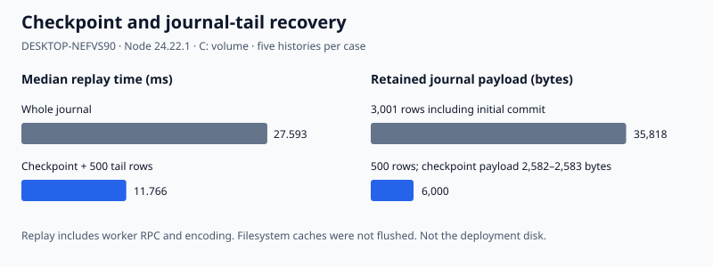

# Instance handoff and checkpoint recovery feasibility

T13's text, lifecycle and local-completion portion and T17's text/recovery portion pass with the existing write-ahead journal and FIFO receipt tracker. The four required defective fixtures fail before positive traces run. **Image P is not run in either trace**; neither complete image-bearing trace is claimed. No app code changes and no new dependency.

## Mechanism and boundary

The opt-in `INSTANCE_OWNER` extension runs on the existing Hocuspocus 4.8.0 child server. A single existing worker owns the only service writer connection, with WAL/FULL checked before any instance operation. Four additive tables hold instances, immutable initial uploads, checkpoints and pruning coverage; the original `updates` schema is unchanged. Management uses one bounded loopback HTTP endpoint; document synchronization and acknowledgements stay on the supported provider path.

`create(k)` stores one pending row under a unique operation key. The owner and invitation are stored as hashes outside shared state. The same k and credentials return the same row. A pending instance cannot authenticate an editor, so it cannot exchange document state. Upload completion retains g0 in a separate transaction. Commit atomically appends the initial binary document, assigns its fresh canonical instance docId, changes pending to committed, and removes staging. A response lost after commit is resolved by the same k. Creation does not delete or write the original file.

The Node handoff captures g0 synchronously and listens to the source's updates while HTTP preparation runs. It records k, captured g0, the allocated instance and all intervening updates locally. Before publishing the invitation it awaits the complete current local membership write and rechecks its injected operation-ownership predicate. The final catch-up and authority handover have no asynchronous gap. A resumed handoff takes its original g0 and k from the completed local envelope, rather than initializing a new CRDT from a projection. The app must supply the real `Operations.capture()`/`stillOwns(ctx)` closure; the Node fixture supplies an ownership predicate and tests its invalidation. This is no claim that the current standalone session already implements shared handoff.

The provider sends the retained incremental work after initialization. Only those new local updates are registered with `ConnectionReceipts`; registering g0 as new work would wait forever when the server's initial state vector omits it from the transmitted difference. A receipt must cover g2 before server-saved appears. A newly joining C has no submitted local edits and displays `Saved on this device` after received state commits locally. Editing through the Node client is refused until synchronization and local hydration completion.

## Assumed local interface

Read against the merged local-store lane, PR #1395, including `local-report.md` and `src/local/store.ts`. No browser module is imported.

The in-process `MemoryCompletionStore` implements the same seven leading arguments and completion result as `LocalReplicaStore.save(editor, network, sequence, manifest, blobs, owns): Promise<number>`, and `hydrate()` returns copied editor/network bytes, sequence, manifest and blobs. It captures bytes synchronously, publishes the record only after its injected transaction-completion gate, returns the captured sequence, and propagates failure. `persistEnvelope` checks that returned sequence. The handoff uses one document for E and N.

There is one explicit assumption beyond the merged browser store: an optional eighth transition envelope and the hydration result carry `{generation, updates, membership, creation: {operation, initial, instance}}` in that same commit. The browser lane does not yet persist this membership/creation catalogue. Its eventual adapter needs that atomic extension; two independently completed writes would not satisfy the modeled contract. Credentials are supplied separately when resuming, never written into that envelope. The model handles an empty manifest and refuses a nonempty one; its images seam has not been connected.

This is an in-process completion model with restart simulated by constructing a fresh handoff over the completed record. It is not a browser, desktop filesystem, eviction or physical-power-loss test. Node join fixtures use a fresh local store, rather than reopening an existing membership with pending offline work.

## Checkpoints and recovery

Capture replays the durable checkpoint and a fixed journal prefix in the writer worker, then synchronously encodes `{document, sequence, payload}` before replying. It does not pair a live document with a later sequence. Installation independently reconstructs the claimed prefix, compares the encoded bytes and sequence, and atomically stores the state with a SHA-256 checksum binding instance, sequence and bytes. Equal or older completions cannot replace a newer durable checkpoint. Failed writes leave coverage unchanged.

Recovery selects the newest checksum-valid, decodable checkpoint that covers the pruning floor, then replays its journal tail. Before pruning, a damaged newest checkpoint can fall back to an older one plus the retained rows. After pruning, corruption that leaves no covering checkpoint refuses hydration, rather than returning partial state. Pruning chooses its coverage inside its own transaction from the newest valid durable checkpoint; rows after that sequence remain. Deletes and allowed pending dependencies are retained in the binary state. Checkpoints here are explicitly requested by the harness; a periodic policy is not selected.

## Trace evidence

All cases live in `test/service/instance/instance.test.ts`, with facts in `facts.ts`. The outer gate runs deliberate defects first. The independent oracle opens SQLite itself, rather than asking the server which rows or checkpoint survived. It decodes sent-message insertion and deletion ranges and checks recovery against that harness-owned ledger. The character oracle uses literal identities via the existing public-relative-position identity checker, never string equality alone.

| Trace / mechanism | Evidence and outcome |
| --- | --- |
| Required defective retry | Two allocated rows are rejected by `assertSingleCreation`; [minimized history](../../../histories/T13-instance-defects.md). |
| Required premature invitation | Pending-server and uncommitted-local fixtures are each rejected by `assertInvitation`; same history. |
| Required lying checkpoint | Old bytes claiming a newer sequence, even with a matching checksum, lose the harness's acknowledged X identity and fail recovery coverage; [history](../../../histories/T17-checkpoint-defects.md). Normal worker installation also refuses this candidate before installation. |
| Required over-pruning | Removing a row beyond checkpoint coverage fails the same independent acknowledged-identity check; same history. |
| T13 normal, duplicate and late C | g0 is `abcd` (`7:0..3`); X and Y are `11:0,1`. Both local and server recover literal `abcdXY`; the pending guest is refused; invitation waits for server commit and held local membership completion; a held g2-containing message leaves sending; its receipt permits server-saved. A duplicate snapshot and empty late join retain all identities. |
| T13 creation kills | Kill before pending insertion, during its transaction, after its commit, during upload, during initialization commit, and after commit before its response. Direct database reads require zero or one row as appropriate; retry returns the surviving id and finishes the same creation. |
| T13 incomplete wire upload | Harness sends only half the declared HTTP body and retains the suffix. After the server reads the prefix, kill it: direct database reads show one pending instance, no uploaded generation and no initial journal row. Retry completes that same instance. No elapsed interval establishes this result. |
| T13 upload restart | g1/g2 and k commit locally while the upload transaction is held. Kill, construct a new handoff from that local record, and retry k: same instance, original g0 upload, `abcdXY` and a covering receipt. |
| T13 ownership/failure | A changed operation predicate prevents switching and invitation publication while the original edited source stays available. A failed local membership write also prevents publication and preserves the source. |
| Checkpoint completion order | Capture old, delete original b, capture and finish new, finish old last. Coverage never decreases. A SQLite trigger failing a later checkpoint leaves old coverage intact. |
| Pure delete / Y14 | State vector is unchanged; journal sequence advances. After checkpoint and prune, deletion coverage and literal `a:7:0 c:7:2 d:7:3` survive. |
| Checkpoint kills | Kill inside checkpoint transaction, after completed checkpoint before pruning, and inside pruning transaction. Recovery and an empty invited late join retain all acknowledged insertion/deletion coverage. |
| Pending dependency | Deliver g2 before g1, checkpoint and prune, kill/restart, then deliver g1 twice. Binary checkpoint preserves pending g2; recovered identities are literal `abcdXY`. |
| T17 journal-only | A types c (`11:0`), B receives it and types d (`12:0`); final receipt covers `abcd`. Both leave, kill/restart, C joins with valid invitation, held local hydration refuses editing, then status is exactly `Saved on this device`. Invalid invitation receives no document. |
| T17 checkpoint and tail | Same history, with checkpoint/prune after c and d in the tail. C gets the same literal identities and instance docId with A/B offline. |
| Credential boundary | T13 local record, independently recovered server document and late join, and T17 C are scanned over decoded logical values and bytes for owner/invite values, hashes and forbidden key shapes. This does not run the real app-data exporter. |

No artifact 8 expected result was changed or declared wrong. The baseline-receipt implementation failure is retained in [T13-baseline-receipt.md](../../../histories/T13-baseline-receipt.md).

## Library facts

| Row | Test and observation |
| --- | --- |
| Y8 | `Y8: hard-deleted payload is GC'd`: default `gc:true`; a hard-deleted string is absent from encoded state and its exported decoded item has `ContentDeleted`. A soft-removed text remains readable after encode/reload. Retaining 10/100 independent 100-character removed texts measured about 1.3/12.9 KiB; exact size varies by client-id encoding. Recovery never reads hard-deleted payload. |
| H14 | `H14: checkpoint load enters broadcast batching`: a test-only extension observes the public `document.flush()` method with a one-byte batch threshold. Loading triggers it with `{loading:true, connections:0, gc:true}`. After load, forced pending-store flush records zero change hooks and zero store hooks; a later live edit supplies the positive change-hook control. No private library method is patched. |
| Y14 | Pure-delete checkpoint test confirms that insertion state vectors cannot establish deletion coverage. |
| Pending-update encoding | Reverse g2/g1 test confirms `encodeStateAsUpdate` retains this same-client pending dependency across checkpoint/prune/restart. No general dependency-validation claim is made. |

No prediction was refuted. Existing receipt/path facts from the journal and refusal lanes are reused and their suites remain in the package gate. Their accepted commit/status ordering limit is unchanged: code structure, not these new kill gates, proves the interval from acquiring the SQLite writer lock to commit returning.

## Image seam

P is **not run**. `StandaloneHandoff.requiredAssetsDurable` and the server extension's `requiredAssetsDurable(payload)` are the two prerequisite seams. The local model rejects nonempty manifests. After the image lane merges, connect its verified blob/membership checks here, include required blob membership in the local atomic transition and checkpoint contract, and rerun T13/T17 with P. No pending-image design or INV-52 change is selected. This text-only result cannot establish the image-bearing trace or the server half of INV-52.

## App handoff entry paths read, not changed

| Audit entry | What integration needs from the current code |
| --- | --- |
| W01 destinations, W02 autosave | Unregister standalone destinations and stop the idle/max policy before switching authority; shared edits need replica persistence. `taking()` selects only when a job starts, so removal cannot cancel a previously selected writer. Also guard immediate/page-event flush routes named in the audit. |
| W06 First Save / Save As | Route to an independent captured export with a fresh docId. `fileTakes()` accepts these requests without consulting home; a blank home alone cannot prevent Save As retargeting. `retargetTo()` currently changes home before writing, and completion can stamp id/revision, relink and reset undo. Those operations cannot target the shared projection. |
| W09 in-flight save | Existing coordinator `job.owns()`/`landed()` uses the captured operation; invalidate the old epoch/ownership before exposing shared state and settle already accepted file/carry work. `landedSave().obsolete()` can still copy fork history, so destination removal alone is insufficient. Original file bytes already accepted by a writer may still land in that original destination. |
| W14 Open | `openProjectFile` awaits parsing, checks its active owner, then `adoptProjectState` installs a file home, document and disk baseline. Dispose the old local-files owner before handoff; a late standalone open must never adopt into the shared session. |
| W31 draft restore; W9/W11 startup | Shared-source startup must hydrate the replica and omit legacy file-draft/stash/last-project replacement. Draft restoration currently opens disk, adopts or locally merges. The local-store lane's startup evidence shows those callbacks can run around hydration. |
| W35 identity/history | Instance id is minted independently; preserve source id/history. Do not run successful standalone Save As identity/history completion against the instance. Independent exports need independent ids; actual export/history integration remains unrun here. |
| W51 Copy/Move | `scriptOnDisk()` requires desktop file home; retain a null script gate in shared mode, cancel/drain old jobs, invalidate their captured operation before any late relink/amendment. |
| W52 Create bundle | `replaced()` schedules inspection on a microtask, and inspection can automatically relink existing bundled paths. Gate it on shared source throughout transition; changing save destinations does not cover it. |
| W53 Save As carry | Main-process accepted carry can outlive renderer destination registration. Settle it before changing authority; shared copy export must not run `confirmWrite()` against the live instance. |
| `adopt(raw)` | Advances epoch and clears/adopts undo, without advancing edit generation. Introduce a deliberate shared hydration/handoff entry; exclude existing standalone whole-document adopters. |
| `stamp(task)` | Bypasses normal edit generation/effects. Save revision/editor stamps and duplicate-file id repair must not mutate shared live state; choose projection-only derivation or an explicit shared write. |
| `Operations.capture()` / `stillOwns(ctx)` | Capture epoch, docId, destination identity/generation and edit generation at initiation. `stillOwns` intentionally compares only epoch/docId/destination identity; typing remains allowed. Keep the incremental catch-up journal independently and check the same ownership context before/after the local final commit. |

INV-35/36's canonical instance id, source separation, retry identity and joining id are covered in this surrogate. INV-48's synthetic shared-content exclusion is checked; real app-data export and standalone export ids are integration work. INV-52 with P remains unrun.

## Shared files changed

| File | Change |
| --- | --- |
| `src/service/journal-client.ts` | Add opt-in instance RPC, terminal-error cleanup and a worker-only transaction gate; ordinary append/read and receipts are unchanged. |
| `src/service/journal-worker.ts` | Lazily create the additive storage helper over its existing writable connection; dispatch instance requests. An injected shared-memory gate can pause an in-progress transaction for a kill. |
| `src/service/server-process.ts` | Compose the opt-in instance boundary/probe, skip whole-journal load when that boundary supplies checkpoint recovery, and add harness checkpoint/capture/prune/phase commands. |

No changes to `journal.ts`, `receipts.ts`, existing harness, refusal files, image files, package manifest, lockfile or root app files.

## Reproduce and measurement

Node 24.22.1, free loopback ports, one test process at a time:

```powershell
$env:TEMP='<temp>/splitpage-lanes/s1b-handoff-recovery'
$env:TMP=$env:TEMP
npm ci
node --test --test-concurrency=1 test/service/instance/instance.test.ts
node test/service/instance/measure-recovery.ts 5
npm test -- --test-concurrency=1
```

Measured on **<machine>**, Windows `10.0.26300`, Ryzen 9 9950X3D2, Node **24.22.1**, at **2026-11-10 03:45 UTC**. The timing script retains all ten samples in `test/service/instance/recovery.local.json`: five fresh histories each with and without a checkpoint. Each history contains 3,000 individually committed one-character updates, after one initial instance commit; checkpoint at 2,500 edits, then a 500-row tail. Replay timing includes worker RPC, checkpoint validation, replay and encoding, after fresh worker startup. Restart/join timing includes a fresh service child, authentication, network hydration and completed local model write. Filesystem caches are not flushed. Database allocated bytes and logical payload bytes are reported separately; pruning does not VACUUM. These are this PC's C: disk measurements, not the deployment volume.



| Case | Replay ms median (range) | Restart and hydrated join ms median (range) | Journal rows / payload bytes | Checkpoint payload bytes | Allocated database bytes |
| --- | --- | --- | --- | --- | --- |
| Whole journal | 27.593 (23.103–32.129) | 350.414 (322.470–377.765) | 3,001 / 35,818 | 0 | 212,992 |
| Checkpoint plus tail | 11.766 (10.327–12.601) | 337.299 (315.274–382.694) | 500 / 6,000 | 2,582–2,583 | 188,416 |

Child startup dominates the second measure; the ranges overlap. These samples establish the observed replay and payload difference on this workload, not a general latency or capacity budget.

Final validation: **1,039/1,039** prototype tests passed with `--test-concurrency=1`, including **26** instance test records (25 subtests and the enforcing parent). Root lint, typecheck, comment and dependency gates passed. No baseline grew. No app unit, browser or desktop suites were run, as required by the brief.

All condition deadlines throw. Kill phases use worker transaction gates; time passing cannot establish a successful absence or durability observation. Children, providers, documents and temporary database folders are closed/killed in `finally`. No browser, app unit suite, desktop suite or physical power-loss experiment is run.
